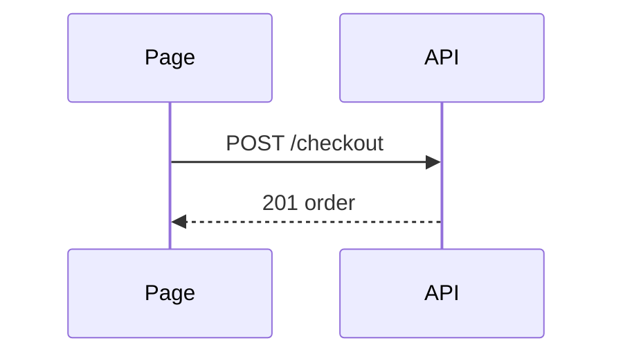

# Body

A reviewer should see the change in a glance. One sentence, then a shape. The evidence and its limits sit under them.

GitHub renders fenced `text`, `diff`, and `mermaid` in a pull request. It will not render an HTML file. A UI mockup is a screenshot from capture.

## Pick one shape

Match the change. A second shape only if it shows something the first cannot.

| Change | Shape |
|--------|--------|
| logic or an algorithm | indented pseudocode |
| runtime control flow | call tree |
| UI structure | component tree, with the files and state that matter |
| layout or a refactor | shallow file tree, one line of responsibility each |
| a small edit to a shape that already exists | a `diff` of that same shape |
| interaction or data flow | a mermaid sequence or state diagram |

Keep only the calls, files, props, states, and boundaries the reviewer needs. Leave the rest out.

## Pseudocode

```text
on(save)
  if draft is empty
    return
  write draft
  show saved
```

## Call tree

```text
submitCheckout
  priceCart
  chargeCard
  placeOrder
```

## Component tree

```text
<CheckoutPage> (app/checkout/page.tsx)
  useCart()
  <PayButton> (packages/ui)
```

## File tree

```text
src/
├── cart/     # line items and totals
└── pay/      # charge and receipt
```

## Diff of a shape

When the surrounding shape already exists, show what moved.

A component:

```diff
 <CheckoutPage>
   useCart()
+  <PayButton />
   <OrderSummary>
```

A call tree:

```diff
 submitCheckout
   priceCart
+  applyGiftCard
   chargeCard
   placeOrder
```

A file tree:

```diff
 src/
 ├── cart/
-└── charge.ts
+└── pay/
+    ├── charge.ts
+    └── receipt.ts
```

Pseudocode:

```diff
 on(save)
-  write draft
+  if draft is empty
+    return
+  write draft
```

Show the whole block when most of it is new, or when omitted lines would hide ownership or order.

## Mermaid

Use it when a sequence or state chart is smaller than the tree. GitHub draws it.



## Prose

The sentence above the shape is how a person talks.

- Lead with the point.
- No em dashes or en dashes.
- No "not X but Y", no "isn't A, it's B".
- No lists of three for rhythm, no throat clearing, no landing line.
- Contractions are fine.

If the repo has a pull request template (`PULL_REQUEST_TEMPLATE.md`, `.github/PULL_REQUEST_TEMPLATE.md`, `.github/PULL_REQUEST_TEMPLATE/*`, `docs/PULL_REQUEST_TEMPLATE.md`), start from that file and fill it. Keep the shape and the evidence.

## Validation record

Include the evidence distinctions from `references/capture.md`: what was demonstrated, which checks executed against which state and with what result, and what remains unverified. Keep failed, blocked, stale, and unrun checks visible. A rendered attachment cannot turn any of those into a passed check.

## Closing line

The last line of the body names the ticket. A closing line (`Closes #42`) closes the ticket on merge, so use one only when this PR delivers every outcome the ticket asks for. Otherwise end with a reference line (`Refs #42`), which links the ticket and leaves it open.

Take the id from the ticket the session built, then from a branch name that starts with the id after any `<prefix>/` (`42-flat-tax`, `eng-42-flat-tax`, or the older `cast/42-flat-tax`). If neither is present, take a ticket id from the commit subjects only when exactly one distinct id appears (`#N`, `ENG-42`, `PLAT-42`, or a `.scratch/.../tickets/` path). Two or more distinct ids: omit the line and name the ones that conflicted. No id anywhere: no line.

**Close or reference.** With a ticket brief in hand, as when cast built the ticket, close only when the spec check found every acceptance criterion met and the PR is not a draft waiting on an unmet criterion. Any criterion still unmet or unverified gets a reference line, including one deferred to later work. Without a brief, as when reveal runs on its own, close unless the body records the change's intended outcome as unmet or unverified, as a draft that says no run passes yet does. When the line references, the report says the ticket stays open and names the unmet criteria. Rewrite the line when a later update to the PR changes the answer.

| Tracker | Closing line | Reference line | On merge |
|---------|--------------|----------------|----------|
| GitHub | `Closes #42` | `Refs #42` | the closing line closes the issue; the reference line only links it |
| Linear | `Closes ENG-42` | `Refs ENG-42` | the closing line closes it through Linear's GitHub integration, when the key is also in the branch name or title; `Refs` skips the merge status |
| Jira | `Closes PLAT-42` | `Refs PLAT-42` | closes only when a Jira automation rule reads it; say so in the report |
| local file | `Closes .scratch/<slug>/tickets/02-<name>.md` | `Refs .scratch/<slug>/tickets/02-<name>.md` | nothing; the builder sets `Status: closed` only after a closing line |

A reference line keeps the ticket open only when nothing else closes it. Keep closing keywords such as `Fixes #42` out of this PR's title and commit messages, since GitHub also closes an issue named that way in a commit that lands on the default branch. On Linear, a key in the branch name can still move the issue on merge under the workspace's automation, and a Jira rule can transition on any merged PR that carries the key. When the ticket stays open on those trackers, the report says to check its status after the merge.

`docs/agents/issue-tracker.md` names the tracker when it exists.
